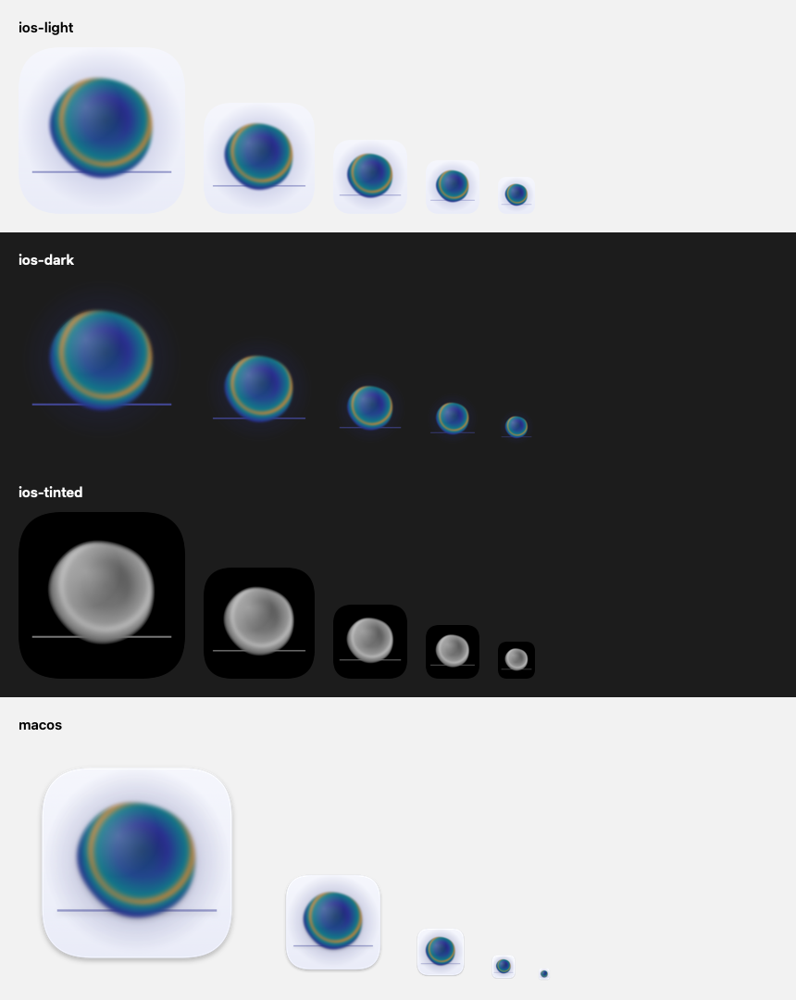
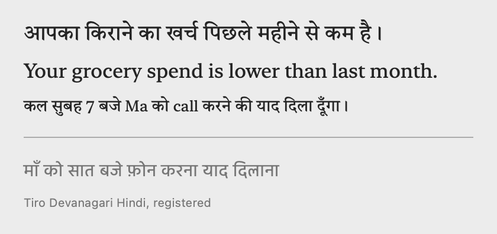
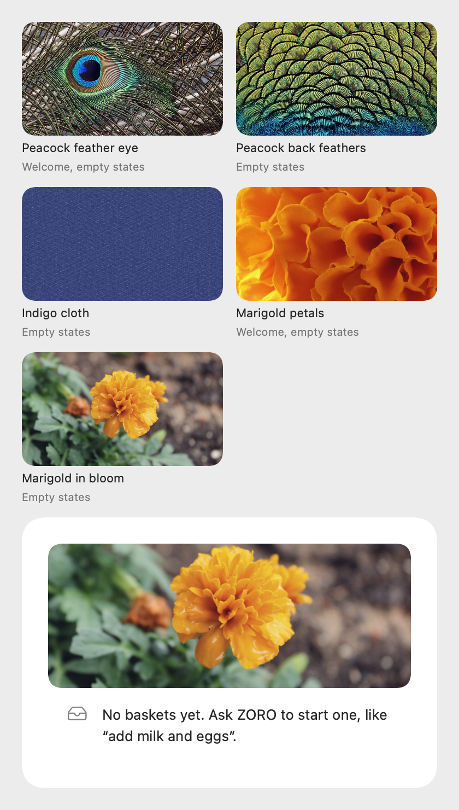
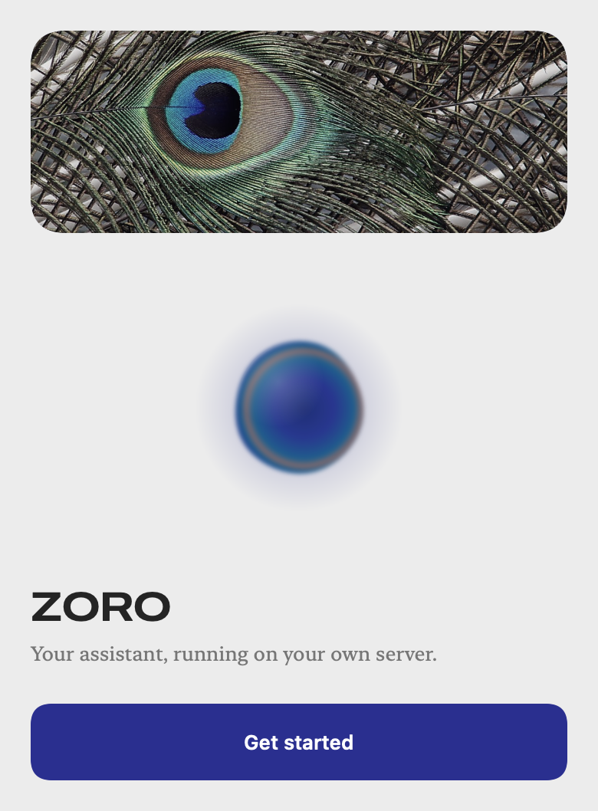

# ZORO assets

Status: **working, compiled and tested on the macOS host** (`scripts/swiftpm.sh ZoroDesign test`: 83
tests pass, 23 of them for assets). Not verified on an iPhone, an iOS simulator or in an Xcode asset
catalog build (no Xcode on this machine).

The identity is fixed by design spec section 10 and `design-system.md`: peacock iridescence (neel,
mor, a thread of genda), one bold element (the orb), one structural idea (the rekha), everything else
quiet. The assets add four things and nothing more: an icon made from the orb, a Devanagari voice for
ZORO, a few photographs of the materials the palette comes from, and four optional sounds.

## 1. App icon

**What it is.** The orb at full iridescence (the frame it takes while agents work, without
satellites), larger than it ever appears in the app, rising from the rekha. Nothing else: no
lettermark, no gradient ground, no glyph.

**Why.** The orb is the one bold element, so the icon is the orb. The rekha is the line the voice
screen is built on; in the icon it is the horizon the orb rises from (ZORO's voice stands on the line).
At 40 px and below the line fades out and the icon reads as the peacock eye alone, which is what we want.

**Decisions from two review rounds.**
1. Round one used the idle orb: at 1024 px its genda thread mixed with neel into a grey-brown ring and
   the whole orb read as out of focus; in the dark variant the dark-appearance hues turned lavender.
   Changed to the full-iridescence frame (mor band and genda ring read as rings) and to the
   light-appearance hues in every variant, which hold their colour on the system's dark icon ground.
2. Round two: the rekha in the dark variant was too bright (periwinkle); lowered to 60 %.

**Variants.**

| Set | Files | Notes |
|---|---|---|
| iOS (Xcode 16+ single-size format) | `assets/AppIcon/ios/AppIcon.appiconset`: `AppIcon-1024.png` (any, opaque, no alpha channel), `AppIcon-dark-1024.png` (transparent ground; the system supplies the dark ground), `AppIcon-tinted-1024.png` (8-bit grayscale on black; the system tints by luminance) | Pale ground: white drawn slightly towards neel, top to bottom |
| macOS | `assets/AppIcon/macos/AppIcon.appiconset`: 16, 32, 128, 256, 512 pt at 1x and 2x | Rounded square on Apple's 824 px grid inside the 1024 px canvas, continuous corners, soft drop shadow |

Known gap: at 16 px on the Mac the orb is a 6 px dot on the tile; it reads as "a blue-green eye" but
nothing more. A hand-tuned 16/32 px drawing would be sharper.

## 2. Typography: Tiro Devanagari Hindi

**What.** Tiro Devanagari Hindi Regular (Tiro Typeworks: John Hudson, Fiona Ross; SIL OFL 1.1), bundled
in `ZoroDesign/Resources/Fonts` with its licence text.

**Why.** ZORO's English words are set in New York, a bookish serif. With the system font, ZORO's Hindi
fell back to a sans and lost that voice. Tiro Devanagari comes from the Nirnaya Sagar Press tradition
of metal types: high-contrast, calligraphic, literary, which is New York's register in Devanagari.
The owner's words stay in SF Pro and the system Devanagari sans, so the two voices stay apart in both
scripts, exactly as the rekha already separates them.

**How it works.**
- `ZoroFonts.register()` registers the font for the process (`CTFontManagerRegisterFontsForURL`,
  scope `.process`), is idempotent and thread-safe, treats "already registered" as success, and
  returns `.registered` or `.unavailable(reason:)`. If unavailable, Devanagari falls back to the
  system face; nothing breaks.
- `ZoroScript.runs(in:)` splits text into Devanagari and other runs; spaces, punctuation and Latin
  digits join the run before them, so a Hindi sentence is one run and a Hinglish line splits only
  where the script changes.
- `ZoroTextStyle.attributed(_:)` sets the Devanagari serif on Devanagari runs for ZORO's styles
  (`.zoroVoice`, `.zoroBody`) only; Latin runs keep New York from `.zoroText(_:)`.
  `ZoroTextStyle.devanagariFont` uses `Font.custom(_:size:relativeTo:)`, so it scales with Dynamic
  Type, at 104 % of the style's size to match New York's x-height.
- `ZoroVoiceText(_:style:)` is the view to use wherever ZORO speaks. `ApprovalSummaryBlock` already
  uses it.

## 3. Photographs

Five photographs, each a material the palette is drawn from. Used on Welcome and in empty states only.
Never behind data, never behind text, never next to an error, loading or disconnected state.

| Artwork (`ZoroArtwork`) | What | Why | Uses |
|---|---|---|---|
| `.peacockEye` | the eye of a tail feather | the orb is drawn after this eye: deep neel centre, mor ring, bronze, barbs | Welcome, empty states |
| `.peacockPlumage` | the scale-like back feathers, gold-green over blue | iridescence as texture, no single focal point | empty states |
| `.indigoCloth` | photo-scanned indigo cotton twill, toned to neel | neel is indigo dye; the quietest of the set | empty states |
| `.marigoldPetals` | marigold petals filling the frame | genda, the warm thread, at full strength | Welcome, empty states |
| `.marigoldBloom` | one marigold in bloom | a single living thing, for "nothing here yet" | empty states |

**Treatment.** Cropped to remove distractions (the striped wing edges, a second flower), resized
(long edge 1022 to 1598 px), sharpening halos softened, then toned with a neel-shadow duotone mixed in
at 14 to 70 % (mor highlights for peacock, genda highlights for marigold, a near-full neel tone for the
cloth), so all five sit in one light. sRGB JPEG, 198 to 359 KB each, all metadata removed.

**Light and dark.** One file per artwork. `ZoroArtworkView` dims it in dark mode (22 % black,
40 % at `.quiet`) and `.quiet` also drops saturation to 55 %, for screens where the orb is visible.

Welcome specimen: a quiet band of the feather, then the orb, then one sentence and one button. Second
review: at standard emphasis the photograph out-shouted the idle orb (rejected); at `.quiet` the orb
leads in dark mode and holds its own in light mode. If the app team finds the band still competes on
a phone, drop it on compact widths and keep it on the Mac.

**Components.** `ZoroArtwork` (catalogue: file, title, uses, focus, fallback hue, credit),
`ZoroArtworkView(_:emphasis:)` (fills its frame, decorative, hidden from VoiceOver),
`ZoroIllustratedEmptyState(_:message:action:)` (artwork band above a `ZoroStateView(.empty, …)`).

## 4. Earcons (optional, off by default)

Four sounds, each a few struck tones on Sa and Pa, the tanpura's drone interval: listen start (Sa→Pa,
0.42 s), listen stop (Pa→Sa, 0.36 s), done (Sa, Ga, Pa, 0.62 s), error (two low strikes a semitone apart,
0.48 s). 16-bit mono WAV at 44.1 kHz, 32 to 54 KB, peak −9 dBFS. They are original works synthesised by
`assets/tools/earcons.py` (additive sine partials, no samples) and dedicated CC0.

`ZoroEarconPlayer` (behind the `ZoroEarconPlaying` protocol) starts disabled, returns `.disabled`,
`.played` or `.unavailable(reason:)`, and never configures the audio session: during a voice session it
plays through the session the voice engine set.

## 5. Licences

Full table, with every file, source URL, author, licence, retrieval date and changes:
[`assets/LICENSES.md`](../../assets/LICENSES.md). Summary:

| Asset | Author | Licence | Source |
|---|---|---|---|
| Tiro Devanagari Hindi | Tiro Typeworks (Indigo Project Authors) | SIL OFL 1.1 | Google Fonts repository |
| Peacock eye, peacock plumage | Bernard Spragg. NZ | CC0 1.0 | Wikimedia Commons |
| Indigo cloth (Denim Fabric 03) | colormass, Rico Cilliers | CC0 1.0 | Poly Haven |
| Marigold petals | Ramya Srivastav | CC0 1.0 | Wikimedia Commons |
| Marigold in bloom | Jesselikesweather | CC0 1.0 | Wikimedia Commons |
| Earcons | ZORO project | CC0 1.0 | original |
| App icons | ZORO project | original work | original |

## 6. Replacing an asset

1. Check the licence on the source page: CC0 / public domain, Unsplash or Pexels licence, MIT, ISC,
   Apache-2.0, or SIL OFL for fonts. No share-alike, no trademarks or logos, no Apple or Siri assets,
   no AI-generated images.
2. **Photograph:** download the original into an empty folder as `<fileName>-source.jpg`, adjust its
   recipe (crop, tone) in `Sources/ZoroDesignSnapshots/ArtworkPipeline.swift`, run the artwork command
   in `assets/tools/README.md`, and look at the result and at `artwork-light.png` / `artwork-dark.png`.
   A new artwork also needs a case in `ZoroArtwork`.
3. **Font:** replace the `.ttf` and its licence file in `Resources/Fonts`, and update
   `ZoroFonts.devanagariSerifPostScriptName` and `devanagariSerifFileName`.
4. **Earcon:** change `assets/tools/earcons.py` and rerun it, or drop in a CC0 WAV under 60 KB with the
   same file name.
5. **Icon:** change `IconArt` in `Sources/ZoroDesignSnapshots/AppIconRenderer.swift`, rerun `--icons`,
   and look at `app-icon-review.png` at every size.
6. Update the row in `assets/LICENSES.md`, then run `scripts/swiftpm.sh ZoroDesign test`. The tests fail
   if a resource is not in the table, a listed file is missing, a licence is not an accepted one, an
   image is over 400 KB, an earcon is over 60 KB, or an icon file does not match its `Contents.json`.

## 7. Verification

| Check | Command | Result |
|---|---|---|
| Build | `scripts/swiftpm.sh ZoroDesign build` | builds, no warnings |
| Tests | `scripts/swiftpm.sh ZoroDesign test` | 83 pass (resources load from `Bundle.module`, font registers and resolves with Devanagari glyphs, licence table matches folders, icon sets match `Contents.json`, script runs, earcons) |
| Dependent package | `scripts/swiftpm.sh ZoroApp build` | builds |
| Snapshots | `scripts/swiftpm.sh ZoroDesign run ZoroDesignSnapshots …` | 14 PNGs plus `app-icon-review.png`, reviewed |
| iOS asset catalog, icon on device | needs Xcode | **not verified here** |
