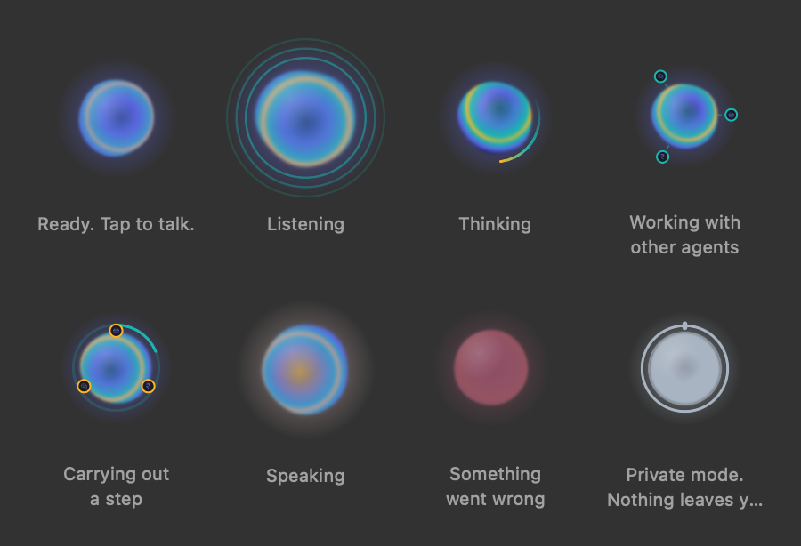
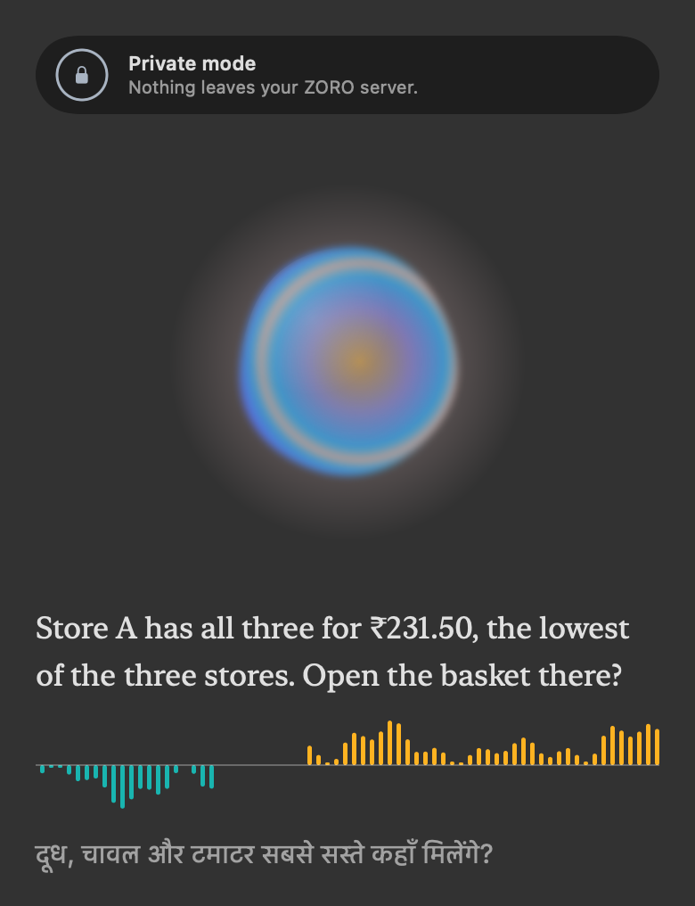
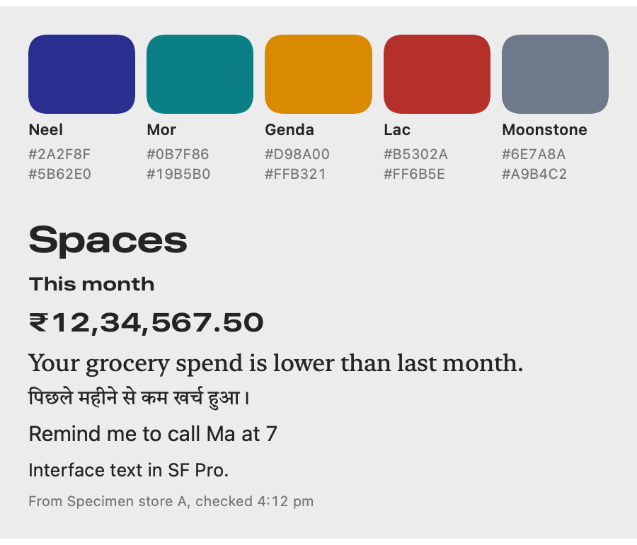
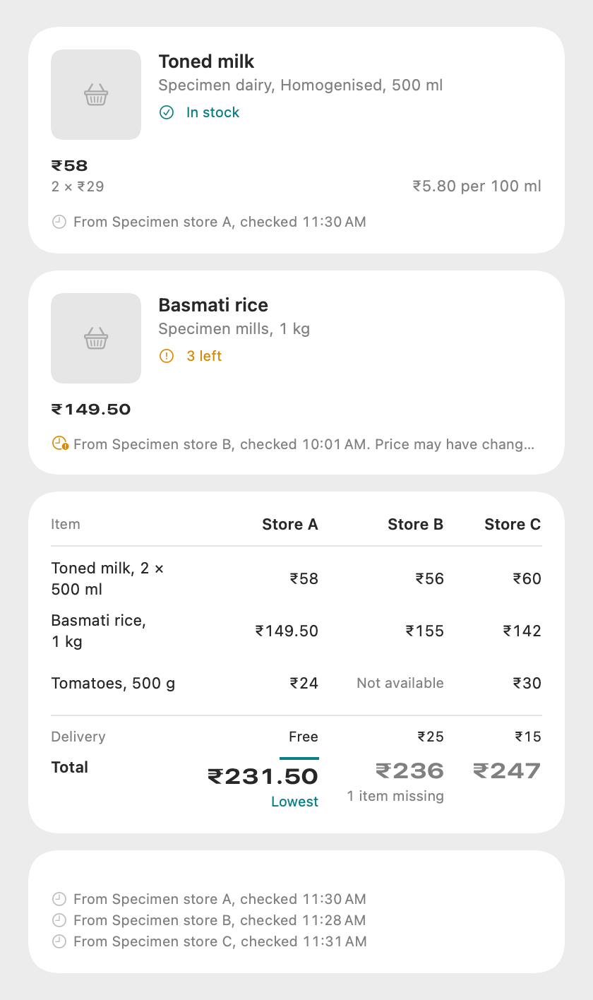

# ZORO design system

Status: **working, compiled and tested on the macOS host** (`ios/Packages/ZoroDesign`, Swift Testing
suite passing). The two iOS-only files (UIKit haptics, UIKit neutral colours) are **not compiled here**;
see "Verification" at the end.

The concept comes from design spec section 10 and stays fixed: an interface that feels native to Apple
platforms, with **one bold element** (the orb) and **one structural idea** (the rekha). Everything else
stays quiet: system materials, system neutrals, SF Symbols, no shadows, no gradients as decoration.

## 1. The two ideas

**The orb: a peacock feather's eye.** The orb is not a glowing sphere or an edge glow. It is drawn
as the eye of a peacock feather: a deep neel centre, a band of mor, one thin thread of genda, and neel
again at the rim. The eye drifts inside a softly deforming body, so the colours shift the way
iridescence does, without spinning. It is Indian in origin, it is ours, and it has nothing in common
with Siri's visuals or with the purple-pink "AI" gradient.

**The rekha: one line.** In Devanagari, letters hang from the headline (the shirorekha). In Latin,
letters stand on a baseline. On the voice screen one horizontal line carries the conversation: **the
owner's voice hangs below it, ZORO's voice rises above it.** The same line appears as the waveform (the
owner's levels hang in mor, ZORO's stand in genda), as the divider in the approval block (ZORO's sentence
above, the facts below), and as the hairline that every section title hangs from.

## 2. Tokens

All tokens live in `Sources/ZoroDesign/Tokens/`. Feature code uses tokens and roles, never raw values.

### Colour

| Hue | Role (`ZoroRole`) | Light | Dark | Light, Increase Contrast | Dark, Increase Contrast | Carries body text at standard contrast |
|---|---|---|---|---|---|---|
| neel (indigo) | `.accent` | `#2A2F8F` | `#5B62E0` | `#1D2170` | `#9CA1FF` | no (dark is 3.5:1 on `#1C1C1E`) |
| mor (peacock teal) | `.positive` | `#0B7F86` | `#19B5B0` | `#065C61` | `#5FDCD6` | yes |
| genda (marigold) | `.attention` | `#D98A00` | `#FFB321` | `#8A5600` | `#FFCB66` | no (fill only in light) |
| lac (red) | `.critical` | `#B5302A` | `#FF6B5E` | `#8C1E19` | `#FF9D94` | yes |
| moonstone | `.privateMode` | `#6E7A8A` | `#A9B4C2` | `#4A5462` | `#D0D7E0` | no |

- Light and dark values are exactly the spec's. The Increase Contrast variants are new; tests prove each
  reaches 4.5:1 on white, `#F2F2F7`, black and `#1C1C1E`.
- Text-safety is **measured** (`ZoroHue.isTextSafeAtStandardContrast`), not declared. Where a hue is not
  text-safe, components switch its text to the Increase Contrast variant automatically (link buttons,
  secondary buttons, capsule badges).
- Labels on a filled hue pick white or black by measured contrast (`ZoroHue.labelOnFill`). The primary
  button is white on neel in both schemes (11.0:1 light, 4.9:1 dark).
- `ZoroColor` is a `ShapeStyle` that resolves from the SwiftUI environment (colour scheme and
  `colorSchemeContrast`), so it works the same in previews, `ImageRenderer`, iOS and macOS with no UIKit
  or AppKit dynamic colours. Use `.foregroundStyle(.neel)`, `.fill(.mor)`, or `ZoroRole.accent.style`.
- Neutrals are system semantic colours (`ZoroNeutral.background`, `.raised`, `.inset`, `.hairline`).
  On macOS these are the window and control backgrounds, so cards are white on a grey window in light mode.

### Type

Every style is built on a Dynamic Type text style, so it scales with the user's text size.

| Token (`ZoroTextStyle`) | Family | Dynamic Type style | Weight | Digits | Extra leading |
|---|---|---|---|---|---|
| `.title` | SF Pro Expanded | largeTitle | semibold | | 0 |
| `.heading` | SF Pro Expanded | headline | semibold | | 0 |
| `.amountHero` | SF Pro Expanded | largeTitle | semibold | monospaced | 0 |
| `.amount` | SF Pro Expanded | title3 | semibold | monospaced | 0 |
| `.zoroVoice` | New York | title2 | regular | | 6 pt |
| `.zoroBody` | New York | body | regular | | 4 pt |
| `.ownerVoice` | SF Pro | title3 | regular | | 6 pt |
| `.body` | SF Pro | body | regular | | 4 pt |
| `.detail` | SF Pro | subheadline | regular | monospaced | 2 pt |
| `.caption` | SF Pro | caption | regular | monospaced | 2 pt |

Apply with `.zoroText(.zoroVoice)`. Extra leading is a `@ScaledMetric`, so it grows with the text, and it
exists because Devanagari matras rise above the Latin cap height. **ZORO's own words are always New York;
the owner's words are always SF Pro.** That, with the rekha, is how a reader tells the two voices apart
without labels or bubbles.

### Space, radius, stroke

- `ZoroSpace`: 2 (hair), 4, 8, 12, 16, 24, 32, 48. Screen gutters 16 on iPhone, 24 on Mac.
- `ZoroRadius` grows with the surface: inset 8, control 12, card 20, sheet 28; chips and badges are
  capsules. All corners are continuous.
- `ZoroStroke`: rekha 1 pt (2 pt under Increase Contrast) drawn in the label colour at 32 % (70 %);
  hairline 0.5 pt.

### Motion

| Token (`ZoroMotion`) | Duration | Curve | Used for |
|---|---|---|---|
| `.quick` | 0.15 s | snappy, no bounce | press, chip selection |
| `.standard` | 0.28 s | smooth | rows and cards updating |
| `.emphasized` | 0.45 s | spring, bounce 0.12 | sheets, approval block, voice screen state changes |
| `.settle` | 0.8 s | ease-out | the orb settling after an error |

Under Reduce Motion every token becomes a 0.2 s cross-fade (`ZoroMotion.animation(reduceMotion:)`, or the
`.zoroAnimation(_:value:)` modifier which reads the environment for you). Motion answers the owner; the orb
is the only thing that moves on its own.

## 3. The orb

`OrbView(state:level:satellites:)` draws `OrbCanvas` inside a `TimelineView`. All numbers are in
`OrbParameters.forState(_:reduceMotion:)` and all geometry is in `OrbGeometry` (pure functions, unit-tested).

| State | What it looks like | Key parameters | VoiceOver value |
|---|---|---|---|
| idle | slow breath (4.2 s), gentle drift of the eye | scale 0.78, breath 2.5 %, deformation 3.5 % | "Ready. Tap to talk." |
| listening | opens wider, edge moves with your voice, mor ripples | scale 0.9, level gain 14 %, ripples | "Listening" |
| processing | full iridescence, eye drifts faster, a mor-to-genda arc turns around it | iridescence 1, arc `.turning` | "Thinking" |
| delegating | body shrinks a little; one satellite per working agent orbits with a dotted tether | satellites `.orbiting`, max 6 | "Working with Shopping and Finance" |
| tool execution | satellites dock on the rim (genda outline), a mor ring sweeps | satellites `.docked`, arc `.sweep` | "Carrying out a step with …" |
| speaking | marigold warmth at the eye, pulses with ZORO's voice | warmth 0.7, level gain 10 % | "Speaking" |
| error | lac tint, one damped shake (0.45 s), then still | alarm 0.75, shake | "Something went wrong" |
| private | moonstone, no iridescence, a sealed double ring with its clasp at 12 o'clock | palette `.moonstone`, ring `.sealed` | "Private mode. Nothing leaves your server." |

Frame budget (`OrbFramePolicy`): 60 fps when visible; 30 fps in Low Power Mode (observed through
`NSProcessInfoPowerStateDidChange`); paused when off screen (`onDisappear`), when the scene is in the
background, and under Reduce Motion. Under Reduce Motion the orb is one static frame: no deformation,
breath, rotation, ripples or shake; it answers sound with halo opacity only, and each state keeps its
palette, ring, arc and satellites, so it is still readable.

Accessibility: one element, label "ZORO", value from `OrbAccessibility.value(state:satellites:)` (it names
the working agents), trait `.updatesFrequently`. The app adds the button trait and tap action.

## 4. Components

| Component | Signature | Notes |
|---|---|---|
| Card | `ZoroCard { … }` | system raised fill, radius 20, no shadow |
| Section header | `ZoroSectionHeader(_ title:, detail:, actionTitle:, action:)` | title hangs from a hairline |
| Chip | `ZoroChip(_ title:, symbol:, isSelected:, action:)` | capsule; neel when selected |
| Buttons | `.zoroPrimary`, `.zoroSecondary`, `.zoroLink`, `ZoroPrimaryButtonStyle(role:)` | min height 50 pt (scaled); no arrows in labels |
| States | `ZoroStateView(_ kind: .empty/.loading/.error/.disconnected, message:, action: ZoroStateAction?)` | one sentence, one optional action, left-aligned |
| Agent row and badge | `AgentActivityRow(_ AgentActivity)`, `AgentBadge(name:symbol:status:)` | statuses: waiting, working, needs your approval, done, couldn't finish |
| Confidence | `ConfidenceBadge(score:)` | ≥ 0.8 "Good match", ≥ 0.5 "Close match", else "Check this" |
| Money | `MoneyText(_ Decimal, style:, textStyle:)`, `ZoroMoney.format` | Indian grouping, `₹`, U+2212 minus, half-away-from-zero to paise |
| Product card | `ProductCardView(_ ProductCardModel, now:)` | name, brand, variant, pack, quantity, price, unit price, stock, image, source line |
| Source line | `SourceLine(stamp:now:)` | "From Instamart, checked 4:12 pm"; marigold clock and "Price may have changed." after 30 min |
| Comparison | `ComparisonTableView(_ ComparisonTableModel, now:)` | best = cheapest store with every item; missing items say "Not available", never 0 |
| Privacy banner | `PrivacyModeBanner(_ mode:, actionTitle:, action:)` | moonstone lock or mor cloud |
| Approval block | `ApprovalSummaryBlock(_ ApprovalSummary, now:, biometricName:, onApprove:, onDecline:)` | ZORO's sentence above the rekha, facts below, expiry, hand-off note |
| Charts | `CategoryBarChart`, `TrendLineChart`, `AllocationRingChart` | Decimal in; Double only for mark positions; labels formatted from Decimal |
| Haptics | `.zoroHaptic(_:trigger:)`, `ZoroHaptics.play(_:)` | listenStart, selection, success, attention, failure, approved |
| Rekha | `RekhaWaveform(userLevels:assistantLevels:)`, `RekhaStage(zoro:owner:)`, `LevelRingBuffer` | silence draws no bar, so the line stays clean |
| Gallery | `ZoroDesignGallery()` | debug builds only, specimen values clearly named "Specimen" |

Component models (`ProductCardModel`, `ComparisonTableModel`, `ApprovalSummary`, …) are display models
with no data of their own. Feature packages map ZoroCore types into them. Every price, stock state and
total is shown with its source and time. `GallerySpecimens` exists only in debug builds for the gallery
and the snapshots; it is never a fallback for missing data.

## 5. Rules

**Layout.** Content is left-aligned. One primary button per screen. Cards only group things that belong
together; a list of rows is one card, not a card per row. Numbers right-align in tables.

**Motion.** Answer what the owner did; never decorate. No entrance animations on lists. The orb is the
only ambient motion, and it stops when it is not on screen.

**Accessibility.**
- Dynamic Type everywhere (text styles and `@ScaledMetric`); layouts wrap rather than truncate except
  amounts, which scale down to 70 % before truncating.
- Reduce Motion: cross-fades only; orb static.
- Increase Contrast: Increase Contrast hue variants, 2 pt rekha at 70 %.
- VoiceOver: orb label and value per state; rows combine into one element; decorative symbols hidden;
  chart marks carry a label and an exact rupee value.
- Colour is never the only signal: every status has words ("Out of stock", "Lowest", "Needs your approval").

**Copy.** See `voice-and-copy.md`. Sentence case, no all-caps, no arrows in buttons, one name per action.

## 6. Snapshots

`scripts/swiftpm.sh ZoroDesign run ZoroDesignSnapshots "<repo>/docs/design/snapshots"` renders eight PNGs
with `ImageRenderer` at 2× (all ≤ 900 px wide): orb states in dark and light, live voice, shopping,
controls and states, agents and approval, charts, palette and type.

Design review notes from two iterations on these images:
1. The first orb used a conic gradient: it read as a pastel pinwheel, and the error state looked pink.
   Replaced with the peacock eye (radial bands drifting inside the blob) and a deepened lac.
2. The rekha read as a dotted line because silent samples drew 1 pt ticks; silence now draws nothing.
   Text buttons used `.borderless`, which `ImageRenderer` cannot draw; they now use `ZoroLinkButtonStyle`.

Known gaps, honestly:
- `ProgressView` (the loading state) renders as a placeholder in offscreen `ImageRenderer` output on this
  host; it renders normally on screen.
- In dark mode the speaking orb leans lavender where marigold warmth meets neel, and the error orb is a
  muted red; a third pass would tint error by replacing gradient stops rather than mixing.
- Snapshots are macOS renders. iPhone layout, Dynamic Type at accessibility sizes and VoiceOver order
  have not been checked on a device or simulator (no Xcode here).

## 7. Verification

| Check | Command | Result |
|---|---|---|
| Build (macOS host) | `scripts/swiftpm.sh ZoroDesign build` | builds, no warnings |
| Tests | `scripts/swiftpm.sh ZoroDesign test` | 60 tests pass (orb parameters per state, frame policy, geometry, satellites, ring buffer, rekha layout, money, models, tokens and contrast) |
| Snapshots | `scripts/swiftpm.sh ZoroDesign run ZoroDesignSnapshots …` | 8 PNGs written and reviewed |
| iOS compile | needs Xcode | **not compiled here**: `Sources/ZoroDesign/iOS/ZoroHapticsUIKit.swift` and `Sources/ZoroDesign/iOS/ZoroNeutralsUIKit.swift` (both marked `UNVERIFIED-ON-HOST`, APIs checked against Apple's documentation). Everything else is shared SwiftUI and compiles on both platforms. |
