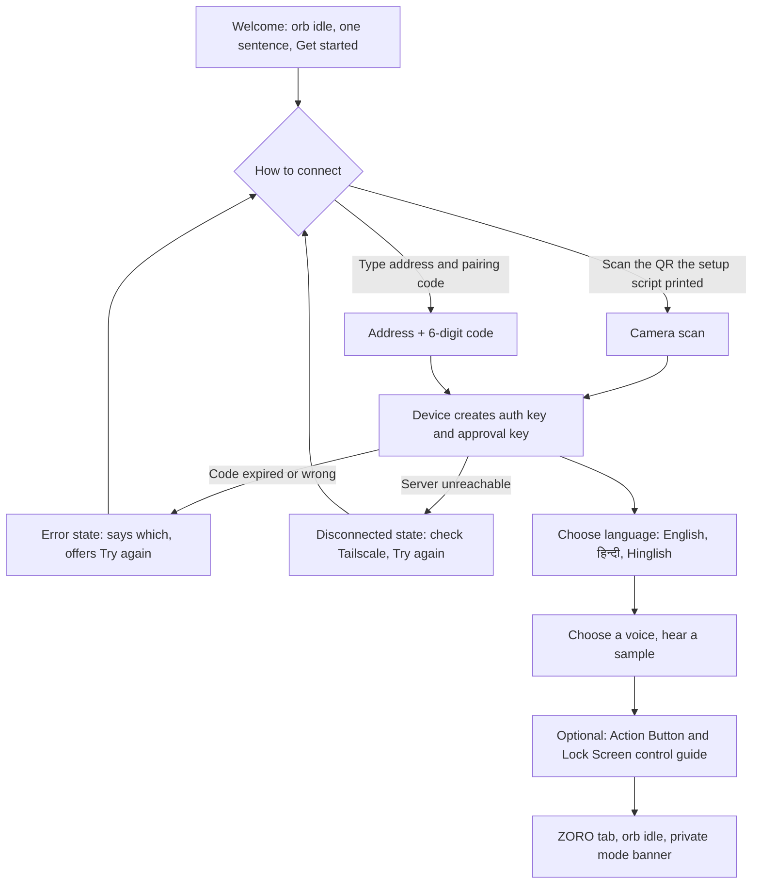
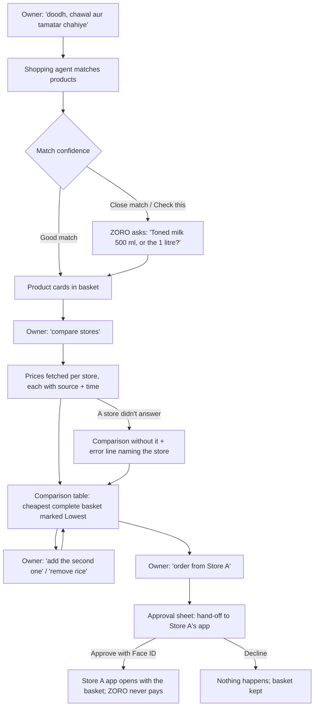
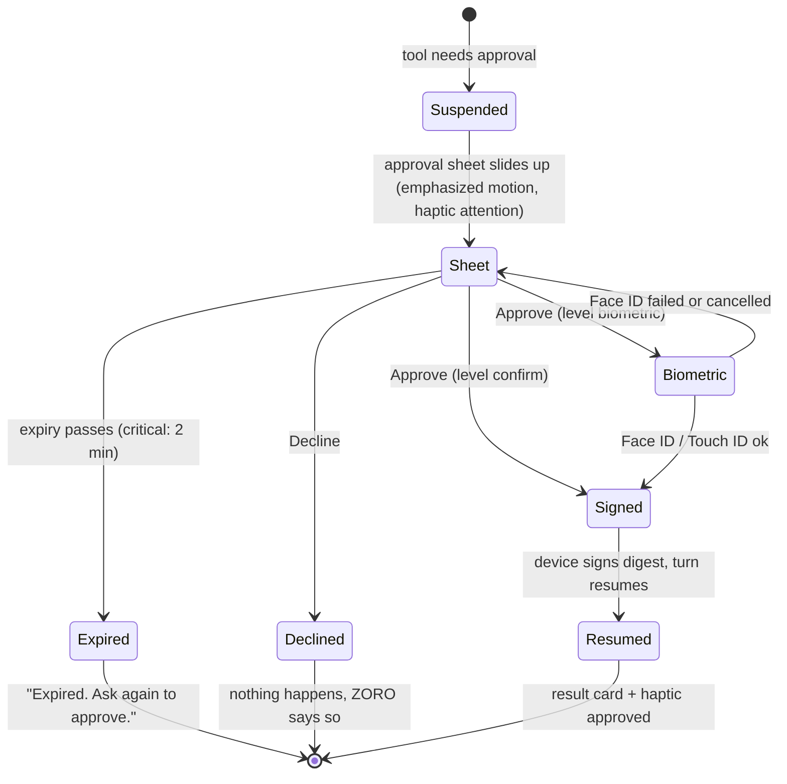
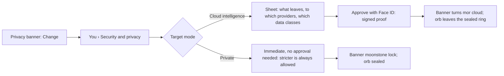
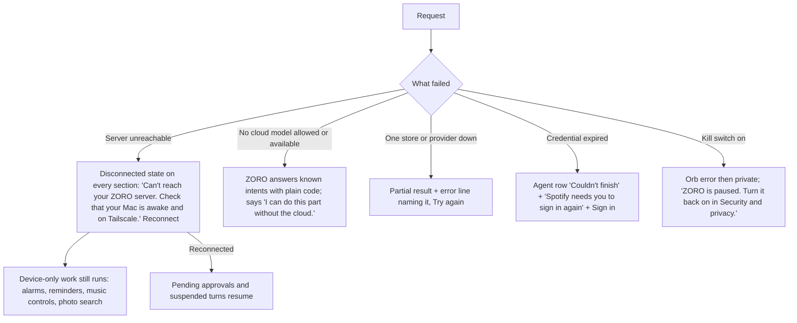

# ZORO user journey

Status: **design**. These flows tell the feature packages (ZoroAppUI, ZoroCommerce, ZoroLife, ZoroSystem)
what to build with the ZoroDesign components. Navigation is fixed by the design spec: iPhone tabs
**ZORO / Spaces / Activity / You**; Mac sidebar with the same sections plus a menu-bar orb. Copy follows
`voice-and-copy.md`; components and tokens are in `design-system.md`.

Prices, totals and times in the wireframes are layout placeholders (`₹…`, `4:12 pm`). Real screens show
only values from a source, each with its source line.

## 1. First run and pairing



- Permissions are **not** asked here. Each is asked the first time a feature needs it, with one sentence
  of purpose (see `voice-and-copy.md`, "Permission prompts").
- Approval-key creation uses Face ID once, with the sentence "Face ID protects approvals. ZORO can't
  approve anything without you."
- The orb is idle on Welcome and turns to private (moonstone, sealed) once paired, because strict private
  mode is the default.

```
Welcome                               Connect
┌─────────────────────────────┐       ┌─────────────────────────────┐
│                             │       │ Connect to your ZORO server │
│            (orb)            │       │ ─────────────────────────── │
│                             │       │ [ Scan the setup QR code  ] │
│ ZORO                        │       │                             │
│ Your assistant, running on  │       │ Server address              │
│ your own server.            │       │ [ zoro.tailnet-name.ts.net ]│
│                             │       │ Pairing code                │
│                             │       │ [ _ _ _ _ _ _ ]             │
│ [        Get started      ] │       │ [         Connect         ] │
└─────────────────────────────┘       └─────────────────────────────┘
```

## 2. Everyday voice turn

```mermaid
sequenceDiagram
    participant O as Owner
    participant A as App (orb)
    participant B as Backend
    O->>A: Action Button / tap orb / "Ask ZORO"
    A->>A: orb listening, haptic listenStart
    O->>A: speaks; words hang below the rekha as they are recognised
    A->>B: turn (text, privacy mode, language)
    A->>A: orb processing
    B-->>A: route + agent events
    A->>A: orb delegating, one satellite per agent
    B-->>A: tool events
    A->>A: orb tool execution (satellites dock, ring sweeps)
    B-->>A: text + cards
    A->>A: orb speaking; ZORO's words rise above the rekha
    O->>A: follow-up ("add the second one"), context kept
```

Live Voice (iPhone, ZORO tab expanded):

```
┌─────────────────────────────────────┐
│ (lock) Private mode                 │  PrivacyModeBanner, Change
│        Nothing leaves your server.  │
│                                     │
│               (orb)                 │  OrbView, top third
│          ◦ Shopping ◦ Finance       │  satellites while agents work
│                                     │
│ Store A has all three for ₹…, the   │  ZORO: New York, stands on the line
│ lowest of the three. Open the       │
│ basket there?                       │
│ ▁▂▅▇▅▃▂▁ ─────────────── ▂▅▇▅▃▁     │  the rekha: ZORO's levels rise,
│ ▔▀▀█▀▔                              │  the owner's hang
│ दूध, चावल और टमाटर सबसे सस्ते        │  Owner: SF Pro, hangs from the line
│ कहाँ मिलेंगे?                         │
│                                     │
│ ┌ Product / comparison cards ─────┐ │  cards scroll under the stage
│ └─────────────────────────────────┘ │
│        [ Stop ]        [ Type ]     │
├─────────────────────────────────────┤
│  ZORO    Spaces    Activity    You  │
└─────────────────────────────────────┘
```

Home (ZORO tab at rest): orb idle in the top third, the last exchange on the rekha, then "Today" with up to
three cards that need the owner (an approval waiting, a stale basket, a reminder due). Nothing else.

```
┌─────────────────────────────────────┐
│ ZORO                       (privacy)│
│                                     │
│               (orb)                 │
│        Ready. Tap to talk.          │
│ ─────────────────────────────────── │  rekha, empty until a turn starts
│                                     │
│ ─ Waiting for you                   │  section titles hang from hairlines
│ ┌─────────────────────────────────┐ │
│ │ Send the message to Asha?       │ │  approval card → approval sheet
│ │ Communications  Needs approval  │ │
│ └─────────────────────────────────┘ │
│ ─ Today                             │
│ ┌─────────────────────────────────┐ │
│ │ Basket at Store A, 3 items  ₹…  │ │
│ │ From Store A, checked 4:12 pm   │ │
│ └─────────────────────────────────┘ │
├─────────────────────────────────────┤
│  ZORO    Spaces    Activity    You  │
└─────────────────────────────────────┘
```

Barge-in: speaking while ZORO speaks stops speech and cancels the turn; the orb goes straight to listening.

## 3. Conversational grocery shopping



Rules: a price older than 30 minutes shows the marigold clock and "Price may have changed." Items a store
lacks say "Not available", and that store's total says how many items are missing; it can never be marked
Lowest. Totals are computed by code, never by a model.

Basket comparison (Spaces › Shopping › Basket):

```
┌─────────────────────────────────────┐
│ ‹ Shopping                Basket    │
│ ─ This basket                       │
│ ┌ [img] Toned milk                ┐ │  ProductCardView
│ │       Brand, 500 ml   In stock  │ │
│ │ ₹…  2 × ₹…        ₹… per 100 ml │ │
│ │ From Store A, checked 4:12 pm   │ │
│ └─────────────────────────────────┘ │
│ ─ Compare stores                    │
│ ┌─────────────────────────────────┐ │  ComparisonTableView
│ │ Item        Store A Store B  C   │ │
│ │ Milk           ₹…     ₹…    ₹…   │ │
│ │ Rice           ₹…     ₹…    ₹…   │ │
│ │ Tomatoes       ₹…  Not avail ₹…  │ │
│ │ Delivery     Free     ₹…    ₹…   │ │
│ │ Total        ▔▔▔                 │ │
│ │              ₹…      ₹…    ₹…    │ │
│ │              Lowest  1 missing   │ │
│ │ From Store A, checked 4:12 pm   │ │
│ └─────────────────────────────────┘ │
│ [     Open basket in Store A      ] │  primary: one per screen
│ [          Compare again          ] │
└─────────────────────────────────────┘
```

## 4. Approving a consequential action



Approval sheet (`ApprovalSummaryBlock`):

```
┌─────────────────────────────────────┐
│                ───                  │
│ Send this message to Asha on        │  ZORO's sentence, New York,
│ WhatsApp.                           │  stands on the rekha
│ ─────────────────────────────────── │
│ To                             Asha │  exact facts hang below
│ Message   Running 10 minutes late,  │
│           start without me.         │
│ (timer) Expires in 1:45             │  critical actions only
│                                     │
│ [      (faceid) Approve with Face ID ] │
│ [             Decline              ] │
└─────────────────────────────────────┘
```

The sheet shows exactly the arguments that will be digested and signed. If the turn is tainted (it read a
web page or an email), the sheet adds: "This came from a web page ZORO read. Check the details." Payments and
orders always end with a hand-off note: "You'll pay in Store A's app. ZORO never pays for you."

## 5. Switching privacy mode



Stricter is instant; looser needs a signed proof. The orb shows the mode at a glance: moonstone and a sealed
ring in private mode, peacock in cloud mode.

## 6. Offline, disconnected and error recovery



Every section has the four states: empty ("No baskets yet. Ask ZORO to start one."), loading ("Checking
prices at 3 stores."), error (what happened + Try again), disconnected (Reconnect). The orb shows error
once (lac, one shake) and then settles back to idle or private; it never stays red.

## 7. The other tabs

Spaces:

```
┌─────────────────────────────────────┐
│ Spaces                              │  SF Pro Expanded title
│ ─ Shopping                          │
│   Basket with 3 items, lists, orders│
│ ─ Finance                           │
│   This month                   ₹…   │  MoneyText, read-only
│   [category bars]                   │
│ ─ Investments                       │
│   [allocation ring]   ₹…            │
│ ─ Fitness   ─ Photos   ─ Music      │
├─────────────────────────────────────┤
│  ZORO    Spaces    Activity    You  │
└─────────────────────────────────────┘
```

Activity:

```
┌─────────────────────────────────────┐
│ Activity                            │
│ [ All ] [ Working ] [ Needs you ]   │  ZoroChip filters
│ ─ Now                               │
│ (basket) Shopping          Working  │  AgentActivityRow
│          Comparing 3 items across 3 │
│ (msg)    Communications  Needs your │
│          Draft ready to send approval│
│ ─ Earlier today                     │
│ (₹)      Finance               Done │
│ ─ History                           │
│   Conversations, newest first  ›    │
├─────────────────────────────────────┤
│  ZORO    Spaces    Activity    You  │
└─────────────────────────────────────┘
```

You:

```
┌─────────────────────────────────────┐
│ You                                 │
│ (lock) Private mode         Change  │  PrivacyModeBanner
│ ─ Memory                            │  what ZORO remembers, review queue
│ ─ Integrations                      │  working / needs credentials /
│                                     │  needs partnership / restricted by iOS
│ ─ Device control                    │
│ ─ Security and privacy              │  devices, kill switch, audit log
│ ─ Settings                          │  language, voice, Action Button
├─────────────────────────────────────┤
│  ZORO    Spaces    Activity    You  │
└─────────────────────────────────────┘
```

Mac: a sidebar (ZORO, Spaces with its six children, Activity, You) and a content column built from the same
components. The menu-bar orb is a 18 pt `OrbCanvas` (static outside a session; animated while the
popover is open). Clicking it opens a popover with the orb, the rekha and the last exchange; ⌥-Space
(configurable) starts listening. The menu-bar icon pauses when the popover is closed, like the iPhone orb
off screen.
